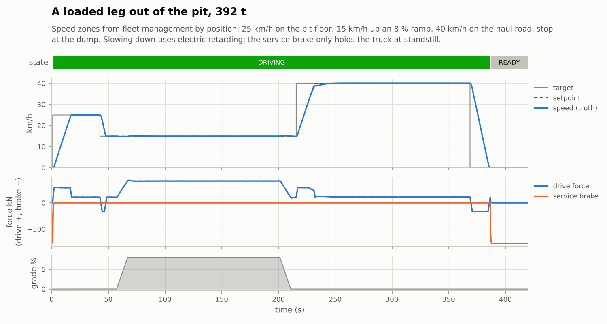
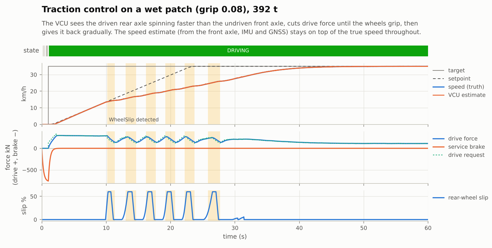
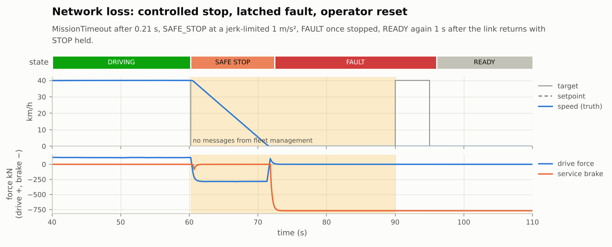
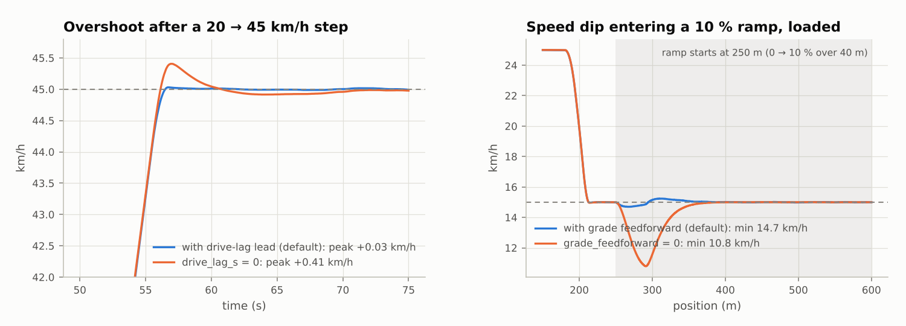
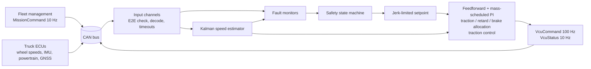

# haul-vcu

A vehicle control unit (VCU) for an autonomous mining haul truck, written in C++20, with a
software-in-the-loop test bench that drives it through 14 scenarios: ramps, wet roads, sensor
failures, corrupted CAN frames, a dead drive motor, network loss and an e-stop.

The VCU sits between fleet management ("drive to the dump at 40 km/h") and the truck's
drive and brakes. Every 10 ms it reads the truck's sensors off a CAN bus, estimates speed,
checks for faults, decides whether the truck is allowed to move, and sends a drive-force and
brake command back. The same code runs against a simulated truck (deterministic, about 4700×
faster than real time on a laptop) and as a real-time process on a CAN interface.



**What's in it**

- **CAN stack:** DBC parser and codec (Intel and Motorola byte order, signed signals, value
  tables), AUTOSAR E2E-style protection (alive counter + CRC-8/SAE-J1850 over a data ID),
  candump log reader/writer, Linux SocketCAN and a CAN-over-UDP transport for machines
  without SocketCAN.
- **Estimation:** a two-state Kalman filter (speed, accelerometer bias) fusing the undriven
  axle, the driven axle when it isn't slipping, GNSS and the IMU.
- **Control:** jerk-limited setpoint profile, road-load feedforward from measured pitch,
  PI gains scheduled by payload, back-calculation anti-windup, force allocation across
  traction, electric retarding and friction brakes, traction control.
- **Safety:** debounced fault monitors, degraded modes, a latched safety state machine,
  controlled safe stop, e-stop, and a watchdog on the truck side.
- **Real-time runtime:** four threads (rx, control, tx, telemetry) joined by lock-free SPSC ring
  buffers, absolute-deadline 10 ms loop, optional real-time scheduling (`SCHED_FIFO` on Linux, the Mach time-constraint policy on macOS), no heap allocation inside the
  control cycle (checked by a test).
- **Verification:** 68 GoogleTest cases, 14 closed-loop scenarios with pass/fail criteria,
  ASan/UBSan and TSan runs, a cross-check of the CAN codec against Python `cantools`,
  clang-tidy, and GitHub Actions CI on Linux (GCC, Clang) and macOS.

## Scenarios

Each scenario is a JSON file in [`scenarios/`](scenarios): road profile, payload, mission,
faults to inject and the checks that decide pass or fail. All 14 pass; the numbers below are
what the checks measured.

| Scenario | What happens | Measured |
|---|---|---|
| `01_flat_cruise_loaded` | 392 t truck pulls away, holds 40 km/h, stops | settles within 0.04 km/h, overshoot +0.02 km/h |
| `02_ramp_climb_loaded` | 15 km/h speed zone up a 10 % ramp near the drive's power limit | stays within 14.70–15.24 km/h through the ramp toe |
| `03_descent_loaded_retarding` | 30 km/h down a 10 % ramp | electric retarding only, service brake peak 0.0 % |
| `04_wheel_slip_wet_road` | pulls away over a wet patch, grip 0.08 | slip detected, traction control, speed estimate within 0.26 km/h |
| `05_gnss_dropout_degraded` | GNSS loses its fix for 40 s | degraded limit 20 km/h (max 20.02), back to 35 km/h after |
| `06_fms_link_loss_safe_stop` | fleet network drops for 30 s | `MissionTimeout` in 0.21 s, stop at ≤1.03 m/s², latched fault, operator reset |
| `07_wheel_sensor_failure` | wheel-speed ECU dies, then GNSS too | carries on at 20 km/h on GNSS + IMU, safe-stops when no speed source is left |
| `08_crc_corruption` | 20 % of wheel-speed frames corrupted for 6 s | every bad frame rejected, `E2EError` raised, speed loop unaffected (±0.02 km/h) |
| `09_stale_imu` | IMU alive counter freezes | repeated frames rejected, degraded mode, recovers |
| `10_emergency_stop` | e-stop at 40 km/h | full brakes next cycle (10 ms), latched until released |
| `11_drive_failure` | drive motors stop producing force on a 6 % ramp | `ActuatorMismatch` after 1.41 s, safe stop on brakes |
| `12_vcu_link_loss` | VCU commands stop reaching the truck | truck-side watchdog brakes after 100 ms, VCU latches a fault |
| `13_speed_steps_empty` | empty 165 t truck, steps 20 → 45 → 25 km/h, same gains as loaded | settles within 0.02 km/h, overshoot +0.03 km/h |
| `14_haul_cycle` | loaded leg out of the pit with position-based speed zones (figure above) | estimate within 0.16 km/h of truth over 420 s |

```
$ haul-sim scenarios/*.json
PASS flat_cruise_loaded                  120 s simulated in    57 ms
PASS ramp_climb_loaded                   220 s simulated in   115 ms
PASS descent_loaded_retarding            150 s simulated in    71 ms
...
PASS haul_cycle                          420 s simulated in   210 ms
14 scenarios, 0 failed
```

### Traction control



The rear (driven) wheels break loose at about 14 km/h. The VCU sees the rear axle running
faster than the front axle, cuts drive force, waits for grip and gives force back gradually.
The speed estimate keeps following the true speed because it trusts the undriven front axle
and stops trusting the rear axle while it slips.

### Losing the fleet network



### What the feedforward terms buy

Two ablations, re-running a scenario with one feature switched off through a calibration
override (`haul-sim --cal key=value`):



| Ablation | Default | Feature off |
|---|---|---|
| Lead the drive's 0.3 s lag with jerk feedforward (`drive_lag_s=0`) | overshoot +0.03 km/h | +0.41 km/h |
| Grade feedforward from measured pitch (`grade_feedforward=0`) | ramp-toe minimum 14.7 km/h | 10.8 km/h (check fails) |

## How it works



`Vcu` has no I/O and no clock. Frames go in through `on_frame()`, time is passed to
`step()`, and frames come out. That one decision is what lets the exact same object run in
the simulator and in the real-time node, and it keeps every test deterministic.

The details (estimator equations, control law, the fault table, the state machine, the
threading model, how the simulator works) are in
[docs/architecture.md](docs/architecture.md).

## Real time

`haul-vcu` runs the VCU on a bus with four threads: rx (blocking receive, pushes into a
lock-free ring), control (wakes on absolute 10 ms deadlines, drains the ring, steps, queues the
frames to send), tx (writes them to the bus) and telemetry (CSV and status output, fed by a
second ring). The control thread never takes a lock, never allocates and never writes to the
bus itself: on macOS a UDP send measured about 650 µs, 90 times longer than the control
cycle's own work, so it moved to its own thread.

Run the truck and the VCU as two processes:

On Linux with SocketCAN:

```bash
sudo ip link add dev vcan0 type vcan && sudo ip link set up vcan0
./build/release/haul-truck --bus socketcan:vcan0 --target-kph 30 --payload-t 227 --duration 60 &
./build/release/haul-vcu --bus socketcan:vcan0 --telemetry vcu.csv
```

Ctrl-C stops the VCU and prints its timing statistics. `candump -L vcan0 > run.log` in another
terminal records the bus.

On macOS, or anywhere without SocketCAN, the same frames go over UDP. Run each in its own
terminal:

```bash
./build/release/haul-truck --bus udp:9001:127.0.0.1:9002 --target-kph 30 --duration 60 --realtime
```

```bash
./build/release/haul-vcu --bus udp:9002:127.0.0.1:9001 --realtime
```

`--realtime` matters on a laptop. Without it, macOS treats both programs as ordinary background
work: it may park them on efficiency cores and batch their timers, and a stall of a few tens of
milliseconds is enough for the VCU to see the powertrain message time out (60 ms) and bring the
truck to a safe stop, which is the correct reaction to a silent ECU. Every state change is
printed the moment it happens, with the reason and the active faults.

Measured on a MacBook Air over UDP loopback, both programs with `--realtime`, one 91 s run
(9076 cycles):

| | p50 | p99 | max |
|---|---|---|---|
| wake-up jitter | 19.8 µs | 43.5 µs | 123 µs |
| cycle compute (drain the rx ring, `Vcu::step`, queue the frames) | 12.1 µs | 27.3 µs | 39 µs |
| bus write on the tx thread (UDP `sendto`) | 625 µs | 1.67 ms | 36.6 ms |
| end of `step()` to frame on the bus | 666 µs | 2.14 ms | 42.0 ms |

0 deadline misses, 0 dropped frames, 0 CRC or sequence errors. Two things the measurements
changed along the way:

- **Scheduling.** The first run on the laptop was without real-time scheduling: wake-up jitter
  was 1.2 ms at the median with stalls up to 36 ms, and four seconds in, a gap in the powertrain
  message tripped its 60 ms timeout and the VCU safe-stopped the truck. That led to the macOS
  `--realtime` mode (Mach time-constraint policy) and to logging every state change with its
  cause, since the once-a-second status line had already cleared the fault.
- **I/O off the control thread.** Splitting the cycle showed the VCU's work took 7 µs and the
  UDP send 652 µs. Writes now happen on their own thread, so the 10 ms loop's timing no longer
  depends on the network stack. The tail of the bus-write latency is macOS loopback UDP; on a
  real target this would be a write to a CAN controller's mailbox.

The same node over UDP on a shared 2-vCPU Linux cloud container, best-effort scheduling, 4001
cycles: wake-up jitter 103 / 232 µs (p50 / p99), 0 deadline misses in that run, but hypervisor
stalls caused up to 11 misses per 4001 cycles in others. Treat all of these as a floor for a
general-purpose OS, not a spec.

Micro-benchmarks (`haul-bench`, Release, same MacBook Air):

| | |
|---|---|
| DBC encode, `VcuCommand` (Motorola) | 97 ns/frame |
| DBC decode | 35 ns/frame |
| E2E CRC-8 | 10 ns/frame |
| One full VCU control cycle (`Vcu::step`) | 0.25 µs (budget: 10 000 µs) |
| SPSC ring, producer and consumer threads | 38 M items/s |
| Whole SIL simulation (600 s scenario) | 4684× real time |

## Verification

- **Unit and integration tests** (`tests/`): DBC parsing and bit layout, encodings pinned
  against `cantools`, AUTOSAR CRC-8 test vectors, the alive-counter state machine, candump
  round trips, the SPSC ring under a 2-million-item two-thread stress test, estimator bias
  learning and gravity compensation, controller feedforward, retarder/brake allocation,
  anti-windup and traction control, every state-machine path, the plant model against
  closed-form physics, scenario parsing, determinism, and the full four-thread node driving
  a simulated truck over UDP.
- **Scenario suite:** all 14 scenarios run as parameterised tests, so `ctest` fails if any
  check fails. CI also publishes the summary table, CSVs, plots and JUnit XML.
- **No allocation in the control cycle:** `tests/test_no_alloc.cpp` replaces global
  `operator new` with a counting one and drives 110 s with corrupted frames, a stale IMU and a
  GNSS outage injected. Zero allocations in `on_frame()`/`step()`.
- **Codec cross-check:** `tools/crosscheck_dbc.py` sends 28 000 random vectors through both
  `cantools` and `haul-can` (encode and decode), then decodes a 160 000-frame candump log
  from a SIL run with `cantools` and re-checks every E2E CRC with an independent bitwise
  CRC-8 written in Python. Everything matches.
- **Sanitizers:** the whole test suite under ASan + UBSan and under TSan. ASan found one real
  bug on its first run: a range-`for` over `j.value(...).items()` iterating into a JSON
  temporary that C++20 had already destroyed. Every functional test had passed with it.
- **Determinism:** scenario CSVs are byte-identical between GCC with libstdc++ and Clang with
  libc++ (sensor noise uses Box–Muller over `mt19937_64` instead of
  `std::normal_distribution`, whose output differs between standard libraries).
- **Static analysis:** clang-format and clang-tidy (bugprone, performance, concurrency,
  clang-analyzer) with warnings as errors; `-Wall -Wextra -Wconversion -Wshadow
  -Wold-style-cast` and friends with `-Werror` in every CI build.

## Build and run

Needs CMake ≥ 3.24, Ninja and a C++20 compiler. Built and tested with GCC 13 (libstdc++) and
Clang 18 (libstdc++ and libc++); the CI workflow adds AppleClang on macOS.
nlohmann/json and GoogleTest are used from the system if present, fetched otherwise.

Build and run the tests (68 of them, about 4 s):

```bash
cmake --preset release && cmake --build --preset release
ctest --preset release
```

Run the scenarios:

| Command | What it does |
|---|---|
| `./build/release/haul-sim scenarios/*.json` | PASS/FAIL per scenario and per check |
| `./build/release/haul-sim --out results scenarios/*.json` | also writes CSVs, JUnit XML and `summary.md` |
| `./build/release/haul-sim --cal kp=0.6 scenarios/13_speed_steps_empty.json` | tries a tuning change without recompiling |
| `./build/release/haul-sim --candump run.log scenarios/04_wheel_slip_wet_road.json` | records every CAN frame of the run |
| `./build/release/haul-can info` | lists the messages and signals in the DBC |
| `./build/release/haul-can decode run.log` | decodes a candump log, with the E2E status of every frame |
| `./build/release/haul-bench` | micro-benchmarks |

Sanitizers:

```bash
cmake --preset asan && cmake --build --preset asan && ctest --preset asan
cmake --preset tsan && cmake --build --preset tsan && ctest --preset tsan
```

Codec cross-check and plots, in a Python virtual environment:

```bash
pip install -r tools/requirements.txt
python tools/crosscheck_dbc.py --haul-can build/release/haul-can --candump run.log
python tools/plot_run.py run results/haul_cycle.csv -o haul_cycle.png
```

Or in Docker: `docker build -t haul-vcu . && docker run --rm haul-vcu`.

## Layout

```
dbc/haul_truck.dbc        the CAN network: 7 messages, 3 nodes
include/haul/, src/
  can/                    DBC codec, E2E, candump, SocketCAN and UDP buses
  vcu/                    estimator, controller, monitors, state machine, Vcu
  sim/                    truck model, sensors and fault injection, scenarios, SIL runner, reports
  rt/                     the four-thread real-time node
  core/                   SPSC ring, latency statistics, units, integer time
apps/                     haul-sim, haul-vcu, haul-truck, haul-can, haul-bench
scenarios/                14 scenario files with their pass/fail checks
tests/                    GoogleTest suites
tools/                    cantools cross-check, plotting
docs/                     architecture notes, figures
```

## Limits, honestly

- The truck model is longitudinal only: no steering, no suspension, no tyre model beyond a
  grip limit on the driven axle. The parameters are in the range of a 220 t-class
  diesel-electric truck, not taken from any manufacturer's data.
- The SocketCAN transport is exercised in CI on a `vcan0` interface when the hosted runner
  provides the module; the development machine for this project had no SocketCAN, so the
  real-time numbers above are over the UDP transport.
- The safety design borrows ideas from ISO 26262 and AUTOSAR E2E (debounced monitors,
  degraded modes, latched faults, alive counters and CRCs, an independent watchdog on the
  actuator side). It is not a certified or assessed safety case.
- Classic CAN only (8-byte frames); no CAN FD, no J1939 transport protocol.

## License

MIT, see [LICENSE](LICENSE).
