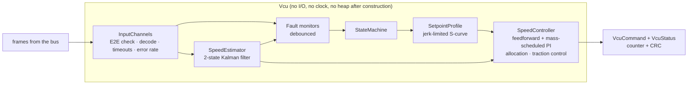
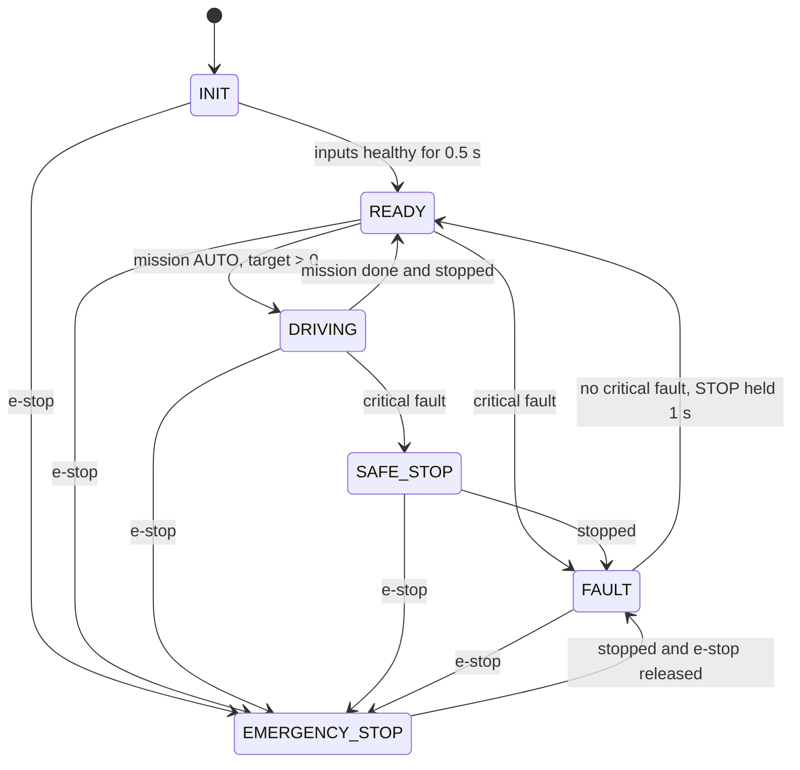
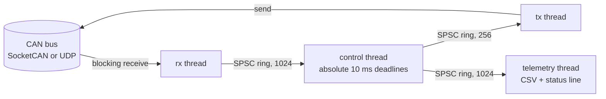

# Architecture and design notes

This is the long version of the README: how one control cycle works, what each fault does,
and why things are built the way they are.

## The network

Three nodes on one CAN bus (classic CAN, 8-byte frames), defined in
[`dbc/haul_truck.dbc`](../dbc/haul_truck.dbc):

| ID | Message | From → to | Period | Contents |
|---|---|---|---|---|
| 0x100 | `WheelSpeeds` | TRUCK → VCU | 10 ms | rear left/right (driven), front axle (undriven), km/h |
| 0x101 | `Imu` | TRUCK → VCU | 10 ms | longitudinal specific force, pitch |
| 0x102 | `Powertrain` | TRUCK → VCU | 20 ms | delivered drive force, brake pressure, payload |
| 0x103 | `Gnss` | TRUCK → VCU | 100 ms | ground speed, fix valid |
| 0x200 | `VcuCommand` | VCU → TRUCK | 10 ms | drive force request, brake request, VCU state (**Motorola** byte order) |
| 0x210 | `VcuStatus` | VCU → FMS | 100 ms | speed estimate, active speed limit, fault flags |
| 0x300 | `MissionCommand` | FMS → VCU | 100 ms | target speed, AUTO/STOP, e-stop |

Every message carries a 4-bit alive counter and a CRC-8 (SAE J1850) in the style of AUTOSAR
E2E Profile 1. The CRC covers a data ID (the message's CAN ID) as well as the payload, so a
frame that lands on the wrong identifier fails the receiver's check even though its own CRC
is intact. `VcuCommand` uses Motorola byte order on purpose, because real vehicle networks mix
both and that is where hand-written codecs usually break (see the cross-check below).

The truck side transmits on staggered phases (0, 2, 4, 6, 8 ms into each cycle) so frames
don't all arrive in the same millisecond, and the GNSS speed is about 100 ms old when it
arrives, as from a real receiver.

## One control cycle (`Vcu::step`, every 10 ms)



1. **Inputs.** Frames arrive through `on_frame()` between cycles. Each `InputChannel` runs the
   E2E receiver state machine (Ok, OkSomeLost, Initial, Repeated, WrongSequence, CrcError),
   throws away anything not usable, decodes the rest into a preallocated buffer, and keeps
   the time of the last good frame. Timeout = max(3 × cycle time, 50 ms).
2. **Estimate speed.** Predict with the IMU (specific force minus g·sin(pitch) minus the
   estimated accelerometer bias), then correct with whatever arrived this cycle: the front
   axle (undriven, so it doesn't spin), the rear axle only while it agrees with the front axle,
   and GNSS. If sources drop out, the filter carries on with what is left; with the IMU gone
   too, speed becomes a random walk and the variance grows, which is visible in telemetry.
3. **Faults.** Each condition goes through a `Debouncer` (must hold for an on-time before it
   counts and be gone for an off-time before it clears) so one bad sample can't stop a truck.
4. **State machine.** Decides whether the truck may drive at all (below).
5. **Setpoint.** The fleet's target speed, capped by the degraded-mode limit if one applies,
   goes through a jerk-limited profile. The profile's acceleration and jerk are the
   controller's feedforward.
6. **Control and allocation.** See below.
7. **Transmit.** `VcuCommand` every cycle, `VcuStatus` every tenth, both counter- and
   CRC-protected.

`Vcu` has no I/O and no clock: the caller passes the time in. The same object runs inside the
simulator (simulated time) and the real-time node (steady clock), which is what makes the
simulator a real test of the shipped code rather than of a model of it.

## Estimator

State `x = [v, b]` (speed, accelerometer bias), with `F = [[1, −dt], [0, 1]]` and the
accelerometer as the control input:

```
v ← v + (a_meas − g·sin(pitch) − b)·dt
P ← F P Fᵀ + Q
```

Measurement updates are scalar (`H = [1, 0]`), one per speed source, with variances
0.03² (front axle), 0.06² (rear axle, gated) and 0.15² (GNSS) in (m/s)². Because a cruising
truck sees an accelerometer that reads its bias while the wheels say "constant speed", the
filter learns the bias; `tests/test_vcu.cpp` checks that it recovers a 0.2 m/s² bias within
0.02 m/s².

## Speed controller

```
F_ff  = m·g·(sin θ + C_rr·cos θ) + ½·ρ·C_dA·v²                  road load
a_cmd = a_sp + τ_drive·j_sp + k_p·e + k_i·∫e                     profile accel, lag lead, PI
F     = m·a_cmd + F_ff
```

* **Mass scheduling.** The PI terms are accelerations multiplied by the current mass (empty
  165 t, loaded up to 392 t, read from the payload signal), so one set of gains behaves the
  same empty or loaded. `13_speed_steps_empty` and the loaded scenarios use identical gains.
* **Grade feedforward.** Cancels the slope from the measured pitch, so the PI part only has to
  correct model error. Without it the loaded truck sags from 15 to 10.8 km/h entering a 10 %
  ramp; with it, to 14.7 km/h.
* **Lag lead.** The drive responds with a ~0.3 s lag. Adding τ·jerk to the feedforward starts
  easing off force before the profile does, which takes overshoot on a 20 → 45 km/h step from
  +0.41 to +0.03 km/h.
* **Allocation.** Positive force goes to the drive motors up to their power limit. Negative
  force goes first to electric retarding (power-limited, fading out below 0.8 m/s), and only
  the remainder to the friction brakes, so brakes stay cold on long descents
  (`03_descent_loaded_retarding` checks the service brake stays under 1 %).
* **Anti-windup.** Back-calculation: the integrator is bled by however much the output was
  clipped. In a 60 s saturation test the integrator settles at a bounded value instead of
  growing to 720 (`AntiWindupKeepsTheIntegratorBoundedWhileSaturated`).
* **Traction control.** When the rear axle runs faster than the front axle by more than
  0.6 m/s or 10 % for 150 ms, drive force is capped at 80 % of what it was at slip onset and
  the cap keeps shrinking (60 %/s) until the wheels grip. Force then comes back at 120 kN/s.

### Setpoint profile

An S-curve with acceleration limited to 0.45 m/s² (0.70 down) and jerk to 0.35 m/s³. The
acceleration is limited near the goal so it can be ramped to zero at the jerk limit exactly
on arrival. The continuous-time rule `|a| ≤ √(2·j·|e|)` left a small residual acceleration
in discrete time, which then had to be dropped in one step: a jerk spike that the lag-lead
feedforward turned into a one-cycle force spike. The profile now uses the exact discrete
form (ramping down from `a = n·J` covers `J·dt·n(n+1)/2`), and a unit test checks that jerk
never exceeds the limit. That bug was found by the test, not by looking at plots.

## Faults and reactions

| Fault | Detected when | Class | Reaction |
|---|---|---|---|
| `WheelSpeedTimeout`, `ImuTimeout`, `GnssTimeout` | no usable frame within the timeout | degraded | 20 km/h limit, estimator drops the source |
| `GnssInvalid` | receiver reports no fix for 300 ms | degraded | 20 km/h limit |
| `WheelSlip` | rear − front > 0.6 m/s or 10 % for 150 ms | (control) | traction control |
| `E2EError` | > 5 rejected frames on an input within 1 s | diagnostic | reported; bad frames were already discarded |
| `MissionTimeout`, `PowertrainTimeout` | no usable frame within the timeout | critical | safe stop |
| `SpeedImplausible` | front axle and GNSS disagree by > 1.2 m/s for 1.5 s | critical | safe stop |
| `ActuatorMismatch` | delivered drive force differs from the lag-filtered request by > 160 kN for 1.2 s | critical | safe stop |
| wheel speeds lost **and** GNSS lost/invalid | | critical | safe stop on IMU dead-reckoning |

E2E errors alone are deliberately not a degraded mode: if enough frames get through, the
data is fresh and correct; if too many are lost, the message times out and that is handled.

The truck side has its own watchdog: if `VcuCommand` stops arriving for 100 ms it removes
drive force and applies the brakes (`12_vcu_link_loss`). A VCU can't protect against its own
output path being cut, so something on the other end has to.

## State machine



* A safe stop always completes, even if the fault clears halfway: the truck doesn't
  oscillate between stopping and driving.
* FAULT is latched. An AUTO command is ignored; the operator has to send STOP for 1 s with no
  critical fault present. That is a deliberate human acknowledgement step.
* Safe stop decelerates at 1.0 m/s² with 2.0 m/s³ jerk (firmer than normal driving but not a
  panic stop, which on a loaded haul truck risks spilling the load or sliding on a wet road).
  E-stop applies full service brakes in the next cycle.

## Real-time runtime (`rt::run_vcu_node`)



* **Absolute deadlines.** The control thread sleeps until `start + k·10 ms`, not "10 ms after
  the last cycle", so lateness doesn't accumulate. After a long stall it resynchronises
  instead of running a burst of catch-up cycles.
* **No I/O on the control thread.** Frames to send go into a ring, and a tx thread writes them
  to the bus, as an AUTOSAR COM layer hands frames to the CAN driver. The control thread wakes
  it with `std::atomic::wait`/`notify_one` (a futex on Linux, `ulock` on macOS) rather than a
  mutex. This came from measuring: on a MacBook Air a UDP `sendto` took about 650 µs at the
  median, while draining the ring and running `Vcu::step` took 7 µs. The report shows both the
  bus-write time and the time from `step()` to the frame being on the bus.
* **Lock-free hand-off.** The rx, tx and telemetry threads talk to the control thread only through
  single-producer/single-consumer rings (acquire/release atomics, head and tail on separate
  cache lines, cached copies of the other side's index). The control thread never waits on a
  lock a lower-priority thread holds, so priority inversion can't happen by construction.
* **No heap in the cycle.** `Vcu::on_frame` and `Vcu::step` allocate nothing: frames come back
  in a fixed-capacity `FrameBatch`, encode buffers are reused, the E2E error history is a
  fixed ring and state-machine reasons are string literals. `tests/test_no_alloc.cpp`
  replaces global `operator new` with a counting one and drives 110 s with faults injected:
  zero allocations.
* **Optional real-time scheduling.** `--realtime` on Linux locks memory (`mlockall`) and requests
  `SCHED_FIFO` priority 80; without `CAP_SYS_NICE` it says so and runs best-effort. On macOS it
  puts the control thread under the Mach time-constraint policy (period 10 ms, computation 1 ms,
  constraint 5 ms), which needs no privileges. On macOS the rx and control threads always ask
  for the "user interactive" QoS class, so they run on performance cores without timer coalescing.
* **Measurement.** Every cycle records wake-up jitter (how late it started) and compute time
  into fixed-size sample buffers; a cycle is a deadline miss if it finishes after the next one
  should have started.

## Simulation

`TruckModel` is longitudinal dynamics for a 220 t-class diesel-electric haul truck:

```
m·dv/dt = F_road − F_brake − m·g·sin θ − C_rr·m·g·cos θ − ½·ρ·C_dA·v²
```

with first-order actuator lags (drive 0.30 s, brakes 0.25 s), power-limited traction
(2.5 MW) and retarding (3.4 MW, fading near standstill), grip-limited force on the driven
axle (so the wheels really spin on a wet patch), and static friction at standstill (a braked
truck on a ramp stays put rather than creeping backwards). The plant's parameters
deliberately differ from the VCU's calibration (rolling resistance 0.028 vs 0.025, traction
power 2.5 vs 2.6 MW, drag area 45 vs 42 m²), so every scenario tests the controller against
model error, not against itself. The model itself is checked against closed-form physics in
`tests/test_sim.cpp` (coast-down deceleration, steady-state speed, power limit, first-order
lag at one time constant, holding on a ramp, grip limit).

`run_sil` steps the plant at 1 ms and the VCU at 10 ms, carries frames over a simulated bus
with 300 µs latency (about one 8-byte frame at 500 kbit/s), and records every frame in
candump format if asked. All time is integer microseconds and the sensor noise is Box–Muller
over `mt19937_64` (whose output the standard pins down bit for bit; `std::normal_distribution`'s
isn't), so a scenario produces byte-identical CSVs with GCC/libstdc++ and Clang/libc++.

### Scenario files

A scenario is a JSON file: truck setup, road profile, wet patches, mission steps (by time or
by position on the road, for speed zones), fault injections, optional VCU calibration
overrides, and `expect`ed checks. Fault types: `drop`, `corrupt_crc`, `freeze_counter`,
`gnss_invalid`, `wheel_bias`, `drive_failure`. Check types: `speed_settles`, `max_overshoot`,
`speed_between`, `state_reached`, `state_never`, `fault_raised`, `fault_never`, `stopped_by`,
`max_decel`, `estimate_error`, `max_brake`. Unknown keys, faults, states and calibration
names are rejected at load time, so a typo can't silently turn a check off.

## Verification, in one list

| What | How |
|---|---|
| DBC codec | unit tests incl. Motorola bit layout; 28 000 random vectors both directions against Python `cantools` (`tools/crosscheck_dbc.py`) |
| E2E | AUTOSAR CRC-8 test vectors; alive-counter state machine; every CRC in a 160 000-frame log re-verified by an independent bitwise CRC in Python |
| Plant model | closed-form physics checks |
| Control and safety logic | unit tests per component; 14 closed-loop scenarios with pass/fail checks |
| Determinism | two runs compared sample by sample; byte-identical output across standard libraries |
| Memory and UB | the whole suite under AddressSanitizer + UndefinedBehaviorSanitizer |
| Threads | the whole suite, including the 4-thread node against a truck over UDP and a 2-million-item ring stress test, under ThreadSanitizer |
| Real time | allocation counter on the control path; jitter and compute-time histograms |
| Style and static analysis | clang-format, clang-tidy (bugprone, performance, concurrency, clang-analyzer) with warnings as errors |

The sanitizer runs found one real bug: a range-`for` over `j.value("vcu", ...).items()` in the
scenario loader iterated a proxy into a temporary JSON object that had already been
destroyed (C++20 only extends the lifetime of the outermost temporary). It passed every
functional test; ASan caught it on the first run.
